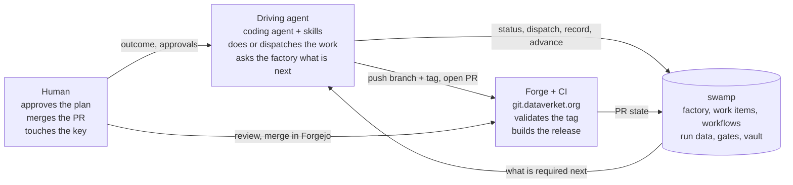
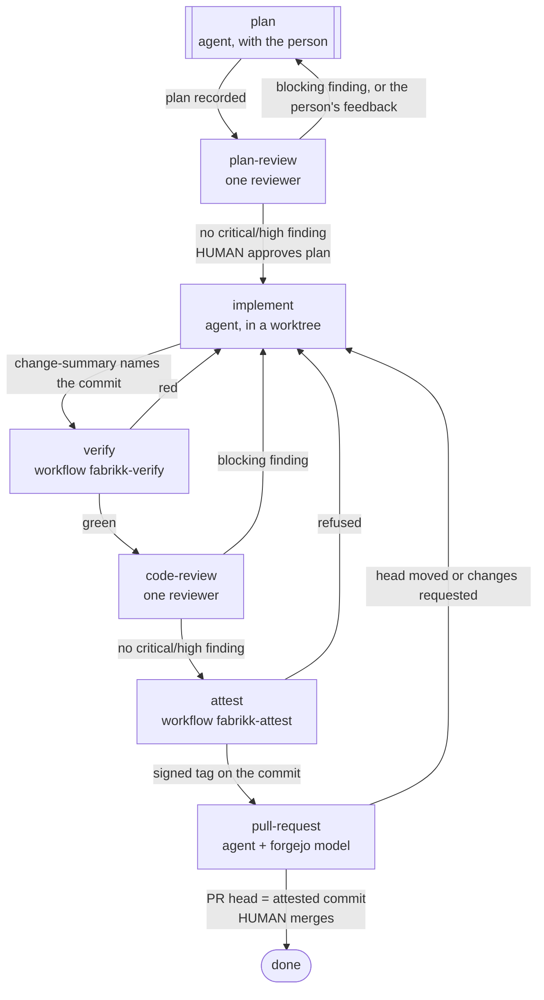

# The factory

fabrikk is a software factory: a state machine that takes a work item (an outcome someone wants) through planning,
adversarial review, implementation, verification, code review, attestation and a pull request, and records every step
as data. It is built on [swamp](https://github.com/swamp-club/swamp) and its `@swamp/stagecraft` extension, and it
follows one idea: **the factory is a program; skills are its context.** The process lives in a stagecraft factory definition and a few swamp workflows. The skills, the constraint
files and the pages in this directory say what good looks like. An agent drives the loop, but the agent never decides
what the next step is. It asks the factory.

## The actors

Four things act, and each has a boundary it cannot cross.

- **The human** writes the outcome, approves the plan, and merges the pull request. Those are the only two approvals in
  the loop. Their YubiKey signs every commit and the attestation tag, so nothing gets signed without a touch.
- **The driving agent** is a session of any enrolled coding tool (`.swamp.yaml` lists them) with the `stagecraft`
  skill, which says how a work item is driven. It does what the current stage's work says: itself (`interactive`),
  by one reviewer sent the prompt the factory prints (`dispatch`), or by running the workflow the factory names
  (`workflow`). It records what was produced and asks again.
- **swamp** holds the factory definition, each work item's pinned copy of it, the workflows and the gates, checks
  every product against its schema, and keeps all of it as versioned data in `.swamp/`. Secrets come from the
  `fabrikk` vault at run time.
- **The forge and CI** are Forgejo at `git.dataverket.org` and its Actions runners. CI never runs the loop; it validates
  the attestation on every pull request push and builds the release candidate after merge.

## The workbench

The first three actors share one machine: the **workbench**. It is a laptop, a VM, or an IncusOS container that holds
the agent, the code, the session stack, and swamp with its run data. The loop never crosses a network: the only
things that leave the workbench are the branch, the signed attestation tag, and the pull request. A workbench never
builds what ships.

One workbench serves many work items at once, and git worktrees are how:

- **The main checkout** is the one `git clone` made. It holds `_reference/`, the tool binaries in `_bin/`, and the
  swamp data every work item reads and writes. Nothing is implemented in it.
- **One worktree per work item**, `git worktree add ../fabrikk-<key> -b <key> main` from the main checkout. The agent
  implements there; `fabrikk-verify` and `fabrikk-attest` run there and refuse a dirty tree or a moved HEAD, so a
  green result is about exactly one commit. When the work item is merged, the worktree goes.
- **One shared session stack** for every worktree: the pods of the `dataverket` stack, each port on the same host
  port. Tests isolate themselves by name, so two work items share it without seeing each other.
- **One private verify stack per commit**: `task verify` plays every product's own manifests, with images built
  from the commit, into the stack `verify-<commit>` and tears it down, so two work items can verify at the same time.

`scripts/functions.sh` names both stacks and never derives a name from a worktree; the rule and what may never be shared are
in the dev-environment skill. Every workbench is meant to be identical, defined as code, and
[contributing/workstation.md](../contributing/workstation.md) is that definition until a bootstrap script exists.
More than one workbench is fine: they share the forge and nothing else.

## The loop

The factory is `slice`, and its definition is `models/@swamp/stagecraft/factory/slice.yaml`: the one copy of the
stages, the prompts, the product schemas and the gates. It was written from stagecraft's `starter` example and keeps
that example's review prompts, severity rubric and loop limits. `task fabrikk.test` checks it and plays its saved
scenarios, the paths through it that must keep working, along with the workflows and the extensions' tests.

Every arrow is a *transition* with *gates*. A gate is a fact the factory can check: an artifact exists, a review is
fresh and has no blocking finding, evidence was recorded with a given value, a CEL expression holds, a person
approved. The agent cannot advance until every gate on a transition passes, and `status` says which gate is in the
way and why. `plan` and `implement` may each be entered five times; past that a person grants an override or
abandons the work.

Two approvals are human and nowhere else: `plan-approval` at `plan-review` and `merge-approval` at `pull-request`.
A third, `abandon-confirmation`, is the way out of any stage. The agent never gives one on its own, and the journal
records who decided. An approval is not enough where a fact is required: the work item is done only if the head the
forge merged is the attested commit.

Release, UAT and promotion are not stages. CI builds the candidate after a merge and `fabrikk-release` can verify
it ([release.md](release.md)); they join the factory when a UAT environment exists.

## What each stage does, and where

| Stage | Who | What happens | Code |
|---|---|---|---|
| `plan` | agent | Turns the outcome into a plan: a summary, the steps with the files each touches, the testing strategy. | `agent-constraints/planning-conventions.md`, the architecture and dev-environment skills, `design/` |
| `plan-review` | one reviewer | A reviewer with no shared context tries to refute the plan, grading by the rubric in its prompt. A critical or high finding sends the plan back. Then the human approves, or sends it back with feedback. | the stage's prompt in the definition, the architecture skill |
| `implement` | agent | Implements the plan in a worktree, tier 0 green, commits signed. Records `change-summary`: the commit, its branch and worktree, the files. | `agent-constraints/implementation-conventions.md` |
| `verify` | swamp workflow | In that worktree, refuses a dirty tree, a moved HEAD, or a commit message carrying AI attribution, then `task check` (tier 0) and `task verify` (tier 2). Results are pinned to the commit. No LLM. | `workflows/workflow-fabrikk-verify.yaml`, `extensions/models/dev_environment.ts`, `extensions/models/git_commit_messages.ts`, `extensions/models/source_standards.ts`, `Taskfile.yml`, `scripts/` |
| `code-review` | one reviewer | A reviewer reviews the commit against the plan, by the same rubric. A critical or high finding sends the change back; the rest go into the pull request's body. | the stage's prompt in the definition, the architecture skill |
| `attest` | swamp workflow | Digests the protected paths, lists which the branch changed, checks that verification, the change summary, its code review and the approval of the current plan all concern the commit, and signs the annotated tag `attestation/<commit>`. | `workflows/workflow-fabrikk-attest.yaml`, `extensions/models/attestation.ts`, `extensions/models/git_paths_digest.ts` |
| `pull-request` | agent + human | Pushes branch and tag, opens the PR through the `forgejo` model, records the PR head from the API. The human reviews and merges in Forgejo; the merge commit and the head that was merged are read back from the API, and a head that is not the attested commit keeps the work item from done. | `models/@dataverket/forgejo/forgejo.yaml`, `.forgejo/workflows/validate-attestation.yaml` |

Source standards has no reviewer. What it asks is either a check (the SPDX header in `task check`, AI attribution at
verify preflight and in CI) or a protected-path change, which a human reviews in Forgejo whatever else is green.

## Where the steering comes from

The agent's judgment is shaped by files in the repository, and every one of them is a protected path: changing them
needs a human in Forgejo, and the attestation carries a checksum of them.

- **The definition** holds each stage's prompt, including the two review prompts and their rubric. The factory fills
  in run data and prints a reviewer's whole prompt, with the query for each product it reads and the file it writes
  its findings to; the driver sends it unchanged.
- **Skills** live in `.agents/skills/`, symlinked into `.claude/skills/`, so every enrolled agent loads them by name.
  A stage lists the skills its work loads. The architecture skill gives the pattern words and one small Go example
  from an unrelated domain (bike rental), so the agent copies the shape and not the domain.
- **`agent-constraints/`** are the `constraints` file of a stage: what fabrikk asks of a plan, and how a change is
  handed over.
- **`design/`** holds what is decided about the stack and the products. The skills point here instead of restating it.
- **The domain model** is `domain/`. It is the only home of domain rules, and a slice that needs it changed changes
  it in the same pull request ([products.md](products.md)).
- **`workflows/` and `extensions/`** are verification and attestation, the parts no prompt can stand in for.

## The loop boundary

The program reaches two things outside the workbench: the forge, through the `forgejo` model with a token that
covers this repository's pull requests and its issues and nothing else, and the registry, anonymously with
`cosign.pub`. It reaches nothing fabrikk-infra deploys and holds no
credential for any of it: no kube context, no fleet key, no registry push credential exists in this repository.
Models for operating that infrastructure (the cluster, the Talos fleet through Omni, the registry's push side, the
release runner, forge-wide settings) live in fabrikk-infra's own swamp, with their own vault, and are used by a human
from that checkout.

**Why.** A workbench runs an agent, and the boundary bounds what an agent that goes wrong can reach: a pull request,
this repository's issues, and a read of the registry. Issues are inside it because a work item's ticket is one. The mirror rule already holds on the other side, where the UAT environment holds no git
credential. The boundary is structural rather than checked: `models/` and `workflows/` are protected paths, so an
instance that would cross it is a change a human sees in Forgejo.

## State is data

Nothing about a work item lives in the agent's conversation. Each work item is a swamp model instance named by its
key, and its records are that model's data.

| Record | Holds |
|---|---|
| `run` | Where the item is, how often each stage was entered, the current version and digest of every product, every dispatch with the prompt that was sent, every approval with who gave it and which product versions it covered, and the journal |
| `definition` | The copy of the factory definition the item pinned when it started; editing the factory never changes a running item |
| `artifact-<name>`, `evidence-<name>` | Each product's payload, versioned per record |

The workflows leave their own records under other models (`git-<sha>`, `dev-env-<sha>`, `attest-<sha>`), always
keyed by the commit they are about, so a result can never be mistaken for another commit's. A new session picks up
where the last one stopped by asking `status`; [contributing/driving.md](../contributing/driving.md) has what is
particular to fabrikk, and the stagecraft skill has the rest.

## Your role

The talk fabrikk is built on (Adam Jacob, *How to build a software factory*) puts it in three lines: define the
outcomes, engineer the factory, and when the outcomes are bad, improve the factory. A work item is an outcome, not
an implementation; if it names an implementation, planning rewrites the outcome first. You talk about outcomes and
architecture; the factory handles implementation. When what comes out is wrong, the fix is in a skill, a constraint,
a design page, a gate, or a workflow, not in the code by hand, and the factory runs again.

## Why this shape

- **Trust comes from the program, not from skills.** Skills are context; a frontier model follows them most of the
  time, which is not good enough for "did the tests run" or "was the plan approved". Those are gates, workflows, and
  signed records. A skill never describes a process; the definition does. See the split in
  [README.md](README.md#where-each-kind-of-knowledge-lives).
- **The attestation checks the records, not the driver's word.** The factory takes a workflow's outcome as evidence
  the driver records. What makes a result count is `fabrikk-attest`: it reads the verification records by commit,
  the code review and the approval from the work item's own data, and refuses to sign unless they are green and
  about that commit.
- **One reviewer, and blocking is for what would ship wrong.** A reviewer told only never to soften rates every
  concern high, and each high costs a round; findings also grow with reviewers times rules times surfaces. So a
  review is one reviewer with a rubric that keeps critical and high for a defect, lost data or a broken rule, and
  scales with the change. The factory's first two attempts are why: eight reviewers recorded 148 findings in six
  cycles without reaching code, and four reviewers spent all five plan-review rounds and 42 findings on a readiness
  skeleton.
- **CI validates, it does not execute.** The loop runs where the agent, the code, and the session stack are on one
  machine (dev-environment skill: never split one loop across a network). CI checks the record of that loop, the
  signed tag, and it builds the release, which a workbench must never do.
- **Data over memory.** A reviewer shares no context with the implementer and reads what it reviews from run data.
  The pull-request stage copies shas from the forge's API. An agent that "remembers" a sha is the failure mode.
- **Humans approve records.** The plan the human approves is the recorded artifact, and the approval is bound to
  that version; the merge is done in Forgejo. The agent presents payloads fetched fresh, never summaries.
