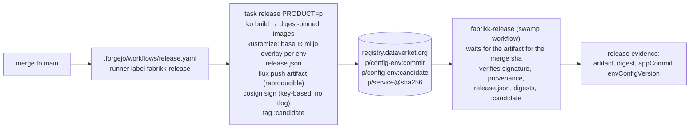
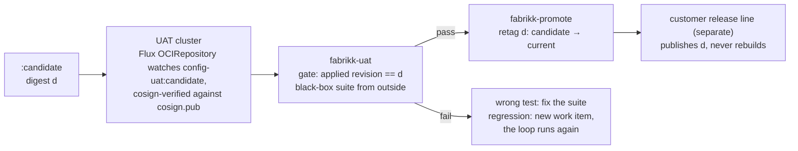

# Release

Git is where releases are authored. The registry is where they travel. The candidate is built once, by CI on shared
infrastructure, after the merge. UAT tests that digest and promotion retags it. Nothing after UAT rebuilds, and a
workbench never builds what ships. The delivery skill (`.agents/skills/delivery/SKILL.md`) is the rule; this page is the
mechanism.

## From merge to candidate

- **L1 and L2.** Each product keeps its environment-agnostic manifests in `<product>/deploy/base/` (L1, next to the
  code). Environment overlays live in the separate `miljo` repository, `environments/<env>/<product>/` (L2, owned by
  the environment line). `task release` joins them: it renders the base with ko-built images pinned by digest, then
  renders every overlay whose kustomization lists `../base`.
- **One artifact per environment.** The rendered manifests and a `release.json` (`product`, `environment`,
  `app_commit`, `env_config_version`, `images`) are pushed as a Flux OCI artifact to
  `<registry>/<product>/config-<env>:<commit>`, reproducibly: the same commit and the same `miljo` version give the
  same digest, so a re-run cannot move a release. The artifact is signed with cosign, key-based, no public transparency
  log, and tagged `candidate`.
- **The digest is the release identity.** `fabrikk-release` records it as `release` evidence. UAT and promotion take
  that evidence and nothing else.

`.forgejo/workflows/release.yaml` runs on push to `main` when a product's files change (only product paths trigger
it; a Taskfile, script or workflow change is exercised by the next product change), on a runner labelled
`fabrikk-release`, with `REGISTRY_USERNAME` and `REGISTRY_PASSWORD` as Actions secrets. `scripts/tools` pins task,
ko, cosign, kustomize, crane, and flux by version and installs them into `_bin/`; the workflow runs it first, so the
runner needs none of them beforehand.

## Where it runs

- `git.dataverket.org` hosts this monorepo, `miljo`, and `fabrikk-infra` (the infrastructure that stands up a fabrikk),
  and is the source of record; Codeberg is a push mirror.
- The registry is zot at `registry.dataverket.org`: anonymous pull, push for `fabrikk-ci`, whose credential the cluster
  repository owns.
- The release runner is `fabrikk-release`, a Kata VM pod in `dataverket-prod` that Flux does not know, defined by the
  `fabrikk-runner` workflow in fabrikk-infra's swamp. The org runner `dataverket-runner` (labels `ubuntu-latest`,
  `kata`) runs pull-request jobs and never carries the signing key. Both need the pod annotation that gives virtiofsd
  `--xattr`, or docker cannot pull images whose files carry capabilities.
- The factory holds no kube context and no credential for what fabrikk-infra deploys ([factory.md](factory.md), the
  loop boundary).

## Not built

Everything below is designed and not built. A factory run today gets through `releasing` and stops at `uat`.

### UAT and promotion

- **`fabrikk-uat`** takes the release artifact recorded in `release` evidence and nothing else. It gates on the applied
  revision equalling the candidate digest, then runs the black-box suite from outside: functional tests always,
  environmental tests where the overlay declares them.
- **`fabrikk-promote`** retags the UAT-passed digest from `candidate` to `current`; rollback retags the previous digest.
- **The customer release line** is separate from this factory. It publishes digests that passed UAT (tag, annotation,
  extra signature, registry copy) and never rebuilds; anything customer-specific happens before UAT.

UAT has to run end to end against a real environment, and there is none.

### The signing key

The cosign private key must never be on disk on the runner: not in Actions secrets, not on a volume. `release.yaml`
today reads `COSIGN_PRIVATE_KEY` from Actions secrets, which contradicts this; no key pair exists yet, and
`cosign.pub` is committed with it, at the repository root, as a protected path.

- **Seeding.** An sshd sidecar in the release runner pod, exposed on its own port through the Envoy gateway.
  `authorized_keys` holds each attester's FIDO key with `restrict,verify-required,command="/seed"` (touch and PIN); the
  forced command reads stdin into an `emptyDir` with `medium: Memory`, mode 0600, and does nothing else. From a laptop:
  `age -d cosign.key.age | ssh -p <port> seed@runner.dataverket.org`. The key is gone on restart.
- **Use, recommended.** The key never enters a job. An OpenBao transit engine with in-memory storage holds it, seeded
  over the same path; `task release` signs with `COSIGN_KEY=hashivault://fabrikk-release` and a sign-only token from
  Actions secrets. Every signature is audit-logged and a job cannot read the key.
- **Use, fallback.** Mount the memory volume read-only into the release job (`runner.config.container.valid_volumes`)
  with the passphrase in Actions secrets. Simpler, but a malicious workflow on that runner can then read the key.
- **Fail fast.** `release.yaml` first checks the key is seeded and fails with the seed command in the message, so a
  restart does not leave `fabrikk-release` waiting out its hour.
- **What this does not defend against.** Forgejo cannot restrict which workflows a runner label accepts, so any
  same-repo pull request can run a job on the release runner and use the key while it is seeded. `.forgejo/` is a
  protected path; the OpenBao shape turns "steal the key" into "sign once, on the record".

### Smaller gaps

Ring or wave promotion and the fleet ledger; the L2 tunable-field linter; SBOMs (`--sbom=none` today); signatures on
individual images; releases triggered by
`miljo` changes (a `miljo` change re-released for the same app commit reuses `config-<env>:<commit>` with a new
digest). `release.yaml` is tested only as an extracted script against a local registry. Every environment is tagged
`candidate` until the customer release line exists.
