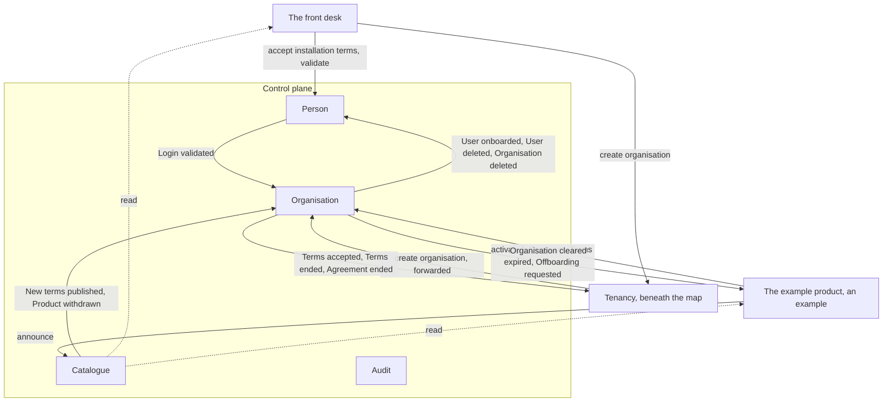

# The map: bounded contexts

The bounded contexts of the control plane, drawn from the pivotal events, roles and language splits on the board. The strongest evidence for a boundary is one word meaning different things on either side of it. Nothing here is a system, a module or a service in the engineering sense; that mapping comes with design.

## At a glance

- **Four contexts on the map, and one beneath it.** The control plane's four serve every product: Person, Organisation, Catalogue and Audit, with Tenancy beneath the map. A product's own contexts are not on it; the stories use the example product, an example and not a context, drawn outside the control plane by its crossings alone.
- **Organisation serves the organisation's things and pins its tenant.** Person and Catalogue are the installation's and pin its organisation's tenant. Audit runs at each provider, the installation among them.
- **The installation is a provider, of the control plane,** and every organisation holds an agreement with it from *Organisation created*. Only the account it owns, with the front desk, tells the installation's organisation apart from a provider; the lines from Organisation to it on this map are the lines to any provider, and its product has no box, since it is the control plane itself.
- **A crossing is a command or an integration event.** Commands are written in the imperative, *announce*; events as facts in the past tense. Each side sends exactly what the other needs and nothing else, and the pivotal events are among the crossings. The full list is [the integration contract](../decisions/integration-contract.md).
- **Where a product reports to the control plane it sends the control plane's command;** where the control plane tells a product it speaks its own language, and a command is answered by a reply. No control-plane context imports a product's event: [the seam decision](../decisions/seam-languages.md).
- **A product meets the control plane at the seam,** and the control plane knows it only there: [the seam](../../method/seam.md).

## Contents

- [Person and Organisation](person-and-organisation.md)
- [Catalogue](catalogue.md)
- [Audit](audit.md)
- [Tenancy](../design/tenancy/boundary.md), beneath the map

## The whole map

Commands are labelled in the imperative, events in the past tense. Every command and every integration event also reaches Audit; those arrows are left out for legibility, as is the arrow by which an organisation's account sends *accept installation terms* and *validate* to Person. The installation's agreement has no arrow of its own: its *Terms accepted* is the first on the arrow to Tenancy, and the control plane holds nothing for the organisation but the organisation itself, so nothing crosses for its offboarding.

## Relationships

Relationship names follow Evans as Stack uses them: a *customer and supplier* line has an upstream side whose language the downstream adopts; *conformist* means the downstream adopts it wholesale; a *partnership* has no upstream, both sides change together; an *open host* publishes a language for anyone; an *anti-corruption layer* translates an outside party's model at the edge.

| Line | Relationship | Meaning here |
|---|---|---|
| Person to Organisation | Customer and supplier, Organisation conforms | Organisation takes Person's person id and a login's validated state as given, and tells Person which logins have users in it |
| Each product to Organisation, at the seam | Published language, Organisation's, the product conforms | The product reads the agreement entry for its own terms, state and quota and the agreement's state, and answers *Offboarding requested* with *Organisation cleared*; Organisation imports nothing of its inside |
| Organisation to the installation, at the seam | The same line as to any provider | The installation's agreement crosses as any agreement does; its product, the control plane, reads nothing and answers nothing |
| Catalogue, outward | Open host, published language | The installation's, published for anyone: the front desk, every product, every provider, the website |
| Audit, downstream of everything | Conformist, with a published language outward | One form of entry, delivered to organisations |
| Every outside party | Anti-corruption layer | The means of validation, BankID and Vipps, into Person; the identity providers for login, FEIDE, Entra ID, Google and others, behind the installation's identity provider |

## Classification

*Core* is what makes this business different and is built with the most care; *supporting* is needed and specific to this business but not why anyone chooses it; *generic* is solved the same way everywhere and is bought and wrapped.

| Class | Contexts | Why |
|---|---|---|
| **Core** | Organisation | An organisation policy that means the same at every provider. The roles and what a rule may say are the system's and must hold everywhere; that portability is the product's claim |
| **Supporting** | Catalogue, Audit | Rules of the provider's own in a known shape |
| **Generic** | Person | BankID, Vipps and the installation's identity provider are Person's adapters |

Core does not mean building the user store: Zitadel holds users and logins as a generic adapter beneath Organisation. What is core is the model on top. Build order starts with Organisation, the root every other context reads from.

## Pivotal events and their contexts

| Pivotal event | Published by |
|---|---|
| Organisation created | Organisation, in the new account; also the birth of the installation's agreement, with the control plane under the terms the visitor accepted |
| Agreement activated | Organisation, once every condition for activation the provider's policy names is met |
| Agreement ended | Organisation; the last of an organisation's is always the installation's |
